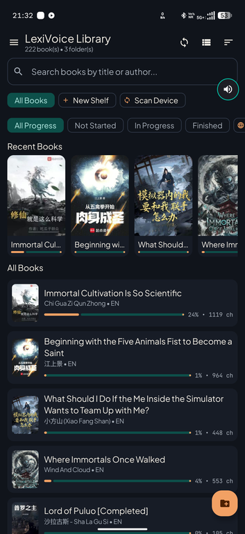
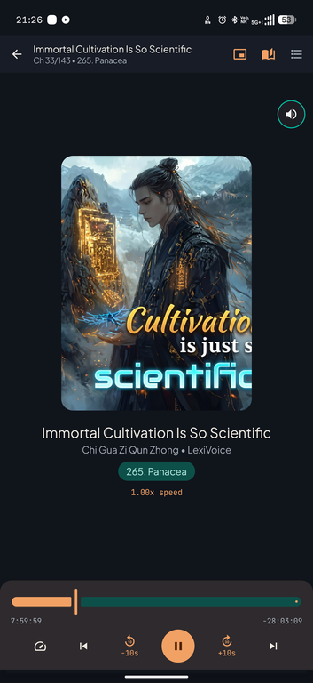

# LexiVoice

**Offline-first EPUB Reader, Text-to-Speech Player, and M4B Audiobook Studio for Android**

[-2A6F68?style=for-the-badge&logo=android&logoColor=white)](https://github.com/ar994885/Lexi-Voice/releases/latest)

[Download Signed APK](https://github.com/ar994885/Lexi-Voice/releases/latest) • [Features](#features) • [Screenshots](#screenshots) • [Installation](#installation) • [Permissions](#permissions)

---

**LexiVoice** turns your local EPUB collection into a distraction-free reading experience, a natural background Text-to-Speech (T2S) player, and a personal audiobook production studio—all running directly on your Android device with zero accounts, subscriptions, or cloud lock-in.

Read comfortably with full publisher typography, listen hands-free with custom pronunciation rules and a floating overlay bubble, or batch-export entire books into ID3v2 cover-embedded **MP3** tracks and chaptered **M4B** audiobooks complete with interactive EPUB **Read-Along** synchronization.

---

## Screenshots

<!-- Replace the placeholder paths below (e.g., docs/screenshots/*.png) with your actual app screenshots (recommended portrait aspect ratio ~9:20, e.g. 1080x2400). -->

| Library | EPUB Reader | M4B Studio & Export | Audiobook Read-Along |

| :---: | :---: | :---: | :---: |

|  |  |  |  |

| *Shelves, folders, covers & filters* | *Edge-to-edge themes & TTS highlight* | *Batch MP3 / chaptered M4B studio* | *Media3 player + synced EPUB view* |

---

## Features

### 1. Distraction-Free EPUB Reader

- **Edge-to-Edge Reading Canvas**: Full-screen book layout with a subtle, non-intrusive footer showing the current chapter title, page count or chapter progress, and overall percentage.

- **True Publisher Fidelity**: Preserves original EPUB stylesheets (`<link>` / inline `<style>`), embedded `@font-face` fonts (`.ttf`, `.otf`, `.woff`, `.woff2`), Ruby annotations (`<ruby>`, `<rt>`), footnotes, tables, and SVG/raster images—or toggle off **Follow Original Book Styling** for clean uniform formatting.

- **Scroll & Paged Reading Modes**: Switch seamlessly between continuous vertical scrolling and paginated book pages, with optional **volume-key page turning** and in-reader brightness control.

- **Navigation & Study Tools**: Built-in Table of Contents drawer, bookmarks, and fast in-book search with sentence-level jump highlighting.

<strong>Reading Themes, Fonts & Custom CSS Options</strong>

- **6 Curated Reading Themes**: *Paper White*, *Warm Sepia*, *Soft Cream*, *Dark Slate*, *AMOLED Black*, and *Eye-Comfort Green*.

- **Custom Theme Editor**: Configure custom background, text, and link hex colors.

- **Typography & Layout Controls**: Choose *Original Book Font*, *Serif*, *Sans-Serif*, *Monospace*, *Dyslexia-Friendly*, or import your own **Custom Font** file; tune font size (`12sp`–`36sp`), line spacing, paragraph spacing, horizontal margins, and text alignment (*Publisher Default*, *Left*, *Justify*).

- **Custom CSS Injection**: Apply custom CSS rules directly inside the EPUB reader.

---

### 2. Text-to-Speech (T2S) & Pronunciation Studio

- **System TTS Engine & Voice Picker**: Discover and switch between all Android TTS engines and voices installed on your device, with fine-grained speed and pitch controls.

- **Smart Paragraph-Level Highlighting**: Splits text naturally without breaking mid-sentence on inline italics or emphasis (`<i>`, `<em>`), keeping highlighted read-along text clean and accurate.

- **Background Media Playback**: Dedicated foreground service with lock-screen media controls and headset/hardware media button support.

- **Speaking Text Process (Pronunciation Rules)**: Define word or regex replacement rules—globally or scoped to specific books—so names, abbreviations, and fantasy terms are spoken accurately.

- **Paste & Speak Scratchpad**: Paste any article, snippet, or notes into a built-in scratchpad and listen immediately without creating an EPUB.

- **Floating Overlay Bubble**: Keep a customizable floating mini-player bubble accessible over other apps with one-tap jump back into your active reading or audiobook position.

---

### 3. Smart Library & Folder Sync

- **Local Folder Watcher**: Connect your device book folders once and automatically scan/index EPUBs with extracted cover art, titles, authors, and languages.

- **Flexible Organization**: Toggle between **List** and **Grid** views (with configurable grid columns), organize books into custom **Shelves**, filter by language, finished, or hidden status, and sort or search instantaneously.

- **Shared Reading & Listening Progress**: Inherit and sync reading progress cleanly between your EPUB book and its linked exported audiobook.

---

### 4. MP3 & M4B Audiobook Studio

- **Batch Chapter Exporter**: Select individual chapters, **Select All**, **Deselect All**, or **Range Select** to synthesize spoken chapters into portable audio files inside organized per-book export folders.

- **ID3v2 Cover-Art MP3 Tracks**: Encode chapter `.mp3` files complete with embedded book cover art and chapter metadata.

- **Direct Chaptered `.m4b` Encoding**: Encode PCM/WAV audio directly to AAC `.m4b` audiobooks with embedded `chpl` chapter markers, `covr` artwork, and metadata tags.

- **Incremental `sync_map.json`**: Automatically generates and updates sentence-level timing alignment maps as you export chapters progressively.

- **Standalone M4B Builder**: Compile existing `.mp3`, `.wav`, or `.m4a` audio tracks into a single chaptered `.m4b` audiobook with custom cover selection and chapter ordering.

---

### 5. Integrated Audiobook Player & Read-Along

- **Unified Audiobooks Tab**: Browse all generated and compiled `.m4b` audiobooks with linked book status and playback progress.

- **Thoughtful Listening Controls**: Powered by Media3 ExoPlayer with chapter sheet navigation, customizable skip-back and skip-forward intervals, and **1-second clamped resume rewind** so you never lose context after pausing.

- **Interactive EPUB Read-Along**: Open the linked EPUB right inside the audiobook player to follow live highlighted text as the narration plays, or **tap any sentence** to seek the audiobook directly to that line.

---

## Installation

1. Open the [**Latest Release**](https://github.com/ar994885/Lexi-Voice/releases/latest) page on GitHub.

2. Under **Assets**, download the signed `.apk` file to your Android device (**Android 8.0 / API 26 or higher**).

3. Tap the downloaded APK and allow **"Install from unknown sources"** for your browser or file manager if prompted.

4. Launch **LexiVoice**, add your EPUB folder under **Manage Folders**, and start reading or generating audiobooks.

---

## Permissions

LexiVoice operates completely offline and only requests permissions needed for the features you choose to use:

| Permission | Purpose |

| :--- | :--- |

| **Storage / All Files Access** | Scan local EPUB folders, import custom fonts/CSS, and save exported MP3/M4B audiobooks to your chosen folders. |

| **Notifications (`POST_NOTIFICATIONS`)** | Display playback controls and live progress while exporting chapters or playing audio in the background. |

| **Display Over Other Apps** *(Optional)* | Required only if you enable the **Floating Overlay** mini-player bubble. |

| **Ignore Battery Optimizations** *(Optional)* | Prevents Android from pausing long multi-chapter TTS-to-MP3/M4B batch exports when the screen is off. |

---

## Built With

- **Language & UI**: Kotlin, Jetpack Compose, Material Design 3, Navigation Compose

- **Audio & Media**: AndroidX Media3 (ExoPlayer & MediaSession), `MediaCodec` / `MediaMuxer` (AAC & `.m4b` chapter muxing), Jump3r (MP3 encoding), Android `TextToSpeech`

- **EPUB & Persistence**: WebKit `WebViewAssetLoader`, Jsoup, Room + KSP, DataStore Preferences, WorkManager, Coil

